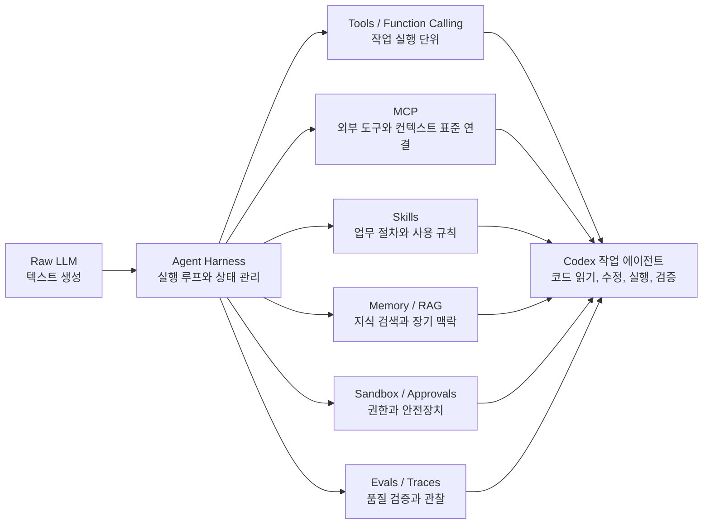
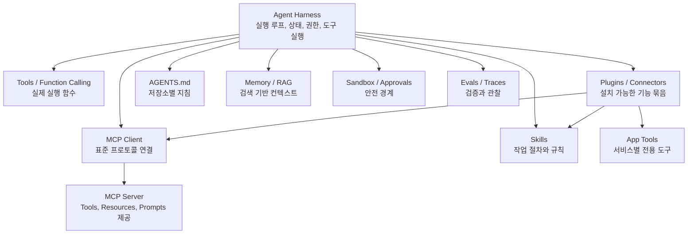

# LLM 보조 도구와 Codex 확장 기술 가이드

이 문서는 `Harness`, `Skills`, `MCP`처럼 LLM을 더 실용적인 작업 에이전트로 만들기 위해 붙이는 보조 계층과 확장 기술을 정리한다. 목적은 개념 백과가 아니라, Codex에서 어떤 확장 수단을 언제 쓰면 좋은지 판단하는 실무 가이드다.

전제: 여기서 말하는 **하네스(Harness)**는 특정 회사나 제품명이 아니라, LLM 주변에서 실행 루프, 도구 호출, 파일 접근, 메모리, 승인, 샌드박스, 오류 복구를 관리하는 **agent harness**를 뜻한다.

## 한눈에 보는 큰 그림

Raw LLM은 텍스트를 생성할 수 있지만, 스스로 파일을 읽거나 명령을 실행하거나 외부 데이터베이스를 조회하지는 못한다. Codex 같은 작업 에이전트는 LLM 바깥에 하네스와 도구 계층을 두어 “생각 → 도구 선택 → 실행 → 결과 반영 → 다음 행동” 루프를 만든다.



## 핵심 비교표

| 기술 | 주 목적 | 호출/제어 주체 | 대표 인터페이스 | 상태/메모리 | Codex에서 보이는 방식 | 장점 | 주요 위험 |
|---|---|---|---|---|---|---|---|
| Agent Harness | 모델을 작업 가능한 에이전트로 감싸는 실행 계층 | 런타임/앱 | 대화 루프, 도구 실행기, 승인 UI, 파일 시스템 접근 | 세션 상태, 실행 이력, 일부 메모리 | Codex CLI/Desktop 자체의 작업 루프 | 긴 작업, 파일 수정, 재시도, 승인 제어 가능 | 하네스 설계가 나쁘면 같은 모델도 실패율 증가 |
| Tools / Function Calling | LLM이 외부 기능을 호출하게 함 | 모델이 선택, 하네스가 실행 | JSON schema, 함수, shell, patch, browser 등 | 보통 호출 결과만 컨텍스트에 반영 | `exec_command`, `apply_patch`, `image_gen`, browser tool 등 | 구체 작업을 정확히 실행 | 권한 과다, 잘못된 인자, 부작용 |
| MCP | 외부 도구/데이터/프롬프트를 표준 방식으로 연결 | MCP client + server | Tools, Resources, Prompts | 서버별로 다름 | Supabase, Notion, Docs MCP, filesystem MCP 등 | 도구 연결 표준화, 재사용성 높음 | 서버 신뢰성, 권한, prompt injection |
| Skills | Codex가 특정 업무 절차를 따르게 함 | 사용자 명시 또는 Codex 자동 선택 | `SKILL.md`, 참조 문서, 스크립트 | 지식은 파일로 존재, 실행 상태는 하네스가 관리 | `$imagegen`, `$openai-docs`, `$superpowers:brainstorming` | 반복 업무 방식 표준화 | 과도한 규칙, 오래된 절차, 도구 의존성 |
| Plugins / Connectors | 기능 묶음을 Codex에 설치/노출 | 사용자 설치, 앱이 노출 | plugin manifest, skill, MCP server, app tools | 플러그인별로 다름 | Browser, Chrome, Notion, Supabase 같은 플러그인 | 배포/설치 단위로 관리 쉬움 | 설치 권한, 외부 서비스 접근 범위 |
| Subagents | 큰 작업을 여러 전문 에이전트로 나눔 | 상위 에이전트 또는 사용자 | handoff, agent-as-tool, parallel task | 에이전트별 컨텍스트 | 코드 리뷰 에이전트, 조사 에이전트, 병렬 분석 | 병렬화와 전문화 | 결과 통합 실패, 중복 작업 |
| AGENTS.md | 저장소별 지속 규칙 제공 | 하네스가 컨텍스트로 주입 | Markdown 지침 | 파일로 지속 | 테스트 명령, 코드 스타일, 금지 사항 | 매번 설명하지 않아도 됨 | 너무 길면 무시되거나 충돌 가능 |
| Memory / RAG | 과거 지식이나 대규모 문서를 검색해 주입 | 하네스/도구/검색기 | vector search, keyword search, memory files | 장기 저장 가능 | 메모리 폴더, 파일 검색, OpenAI file search 등 | 컨텍스트 한계 보완 | 오래된 기억, 잘못된 검색 결과 |
| Sandbox / Approvals | 실행 권한과 위험 작업 통제 | 하네스/사용자 | approval mode, sandbox policy | 승인 이력 정도 | 파일 쓰기 제한, 네트워크 승인, 명령 승인 | 사고 방지 | 너무 엄격하면 작업 지연 |
| Evals / Traces | 에이전트 품질 검증과 디버깅 | 개발자/운영자 | test suite, trace span, run logs | 실행 기록 저장 | 코드 리뷰, 테스트, 실행 로그 분석 | 회귀 방지, 실패 원인 파악 | 지표가 잘못되면 착시 |

## 1. Agent Harness

### 무엇인가

Agent Harness는 LLM 바깥에서 모델 호출, 도구 호출, 결과 반영, 파일 접근, 상태 관리, 승인, 샌드박스, 오류 복구를 담당하는 실행 계층이다. 모델은 “다음에 무엇을 할지”를 제안하고, 하네스는 실제 환경에서 그 행동을 실행할지 결정하고 결과를 다시 모델에게 전달한다.

OpenAI는 Agents SDK의 하네스를 파일, 도구, 샌드박스, 메모리, MCP, Skills, shell, patch 같은 프리미티브를 묶는 인프라로 설명한다.[^openai-agents-harness]

### LLM에 어떤 도움을 주는가

- LLM이 한 번의 답변으로 끝내지 않고 여러 단계 작업을 이어갈 수 있게 한다.
- 파일 읽기, 코드 수정, 명령 실행, 브라우저 검증 같은 실제 행동을 가능하게 한다.
- 오류가 나면 다시 읽고 고치고 재실행하는 루프를 만든다.
- 권한과 샌드박스를 통해 위험 작업을 통제한다.

### Codex에서는 어떻게 보이는가

Codex CLI/Desktop 자체가 하네스 역할을 한다. Codex는 선택된 작업 디렉터리에서 파일을 읽고, 코드를 수정하고, 명령을 실행하는 coding agent로 설명된다.[^openai-codex-cli] 사용자는 raw model을 직접 조작한다기보다 Codex 하네스 위에서 모델과 협업한다.

### 언제 쓰면 좋은가

- 여러 파일을 읽고 수정해야 하는 작업
- 테스트를 실행하고 실패를 바탕으로 고쳐야 하는 작업
- 외부 도구와 로컬 파일 시스템이 함께 필요한 작업
- 사용자 승인과 권한 통제가 중요한 작업

### 대표 예시

- “이 API에 pagination 추가하고 테스트까지 돌려줘”
- “프론트엔드 UI를 수정한 뒤 브라우저로 확인해줘”
- “Supabase migration을 만들기 전에 현재 schema와 RPC를 확인해줘”

### 주의할 점

하네스는 모델의 능력을 키우는 동시에 실패 표면도 넓힌다. 도구 설명이 불명확하거나 권한이 너무 넓거나, 실행 결과를 잘못 요약하면 모델은 잘못된 다음 행동을 선택할 수 있다.

## 2. Tools / Function Calling

### 무엇인가

Tool은 LLM이 호출할 수 있는 외부 기능이다. Function calling은 그중에서도 함수 이름, 입력 schema, 반환값을 정해 모델이 구조화된 방식으로 함수를 호출하게 하는 패턴이다. OpenAI Agents SDK는 hosted tools, local runtime tools, function tools, agents as tools, Codex tool 같은 여러 도구 유형을 구분한다.[^openai-agents-tools]

### LLM에 어떤 도움을 주는가

- 계산, 검색, 파일 조작, API 호출처럼 텍스트 생성만으로는 못 하는 일을 수행한다.
- 함수 schema가 있으면 모델이 자연어 대신 구조화된 인자를 만들 수 있다.
- 실행 결과를 다시 컨텍스트에 넣어 다음 판단의 근거로 쓴다.

### Codex에서는 어떻게 보이는가

Codex의 셸 실행, 파일 패치, 이미지 생성, 브라우저 조작, Notion/Supabase 앱 도구 등이 모두 넓은 의미의 tool이다. 사용자가 “테스트 돌려줘”라고 말하면 모델이 셸 도구를 호출하고, “파일 수정해줘”라고 말하면 패치 도구를 호출한다.

### 언제 쓰면 좋은가

- 입력과 출력이 명확한 작업
- 외부 시스템 조회나 변경이 필요한 작업
- 반복적으로 자동화할 만한 절차

### 대표 예시

- `run_tests(project_path)`로 테스트 실행
- `query_database(sql)`로 DB 조회
- `create_issue(title, body)`로 이슈 등록
- `apply_patch`로 코드 수정

### 주의할 점

Tool은 실제 부작용을 만들 수 있다. 삭제, 결제, 메일 발송, DB 변경 같은 도구는 반드시 승인 정책, dry-run, 감사 로그, idempotency를 고려해야 한다.

## 3. MCP (Model Context Protocol)

### 무엇인가

MCP는 애플리케이션이 LLM에게 도구와 컨텍스트를 제공하는 방식을 표준화하는 프로토콜이다. OpenAI Agents SDK 문서는 MCP를 “AI 애플리케이션을 데이터 소스와 도구에 연결하는 USB-C 같은 표준”이라는 공식 설명으로 소개한다.[^openai-agents-mcp]

MCP 서버는 보통 Tools, Resources, Prompts 같은 프리미티브를 제공한다.[^mcp-server-concepts]

| MCP 프리미티브 | 의미 | 누가 주로 제어하나 | 예시 |
|---|---|---|---|
| Tools | 모델이 호출할 수 있는 실행 기능 | 모델 주도, 사용자 승인 가능 | DB query, GitHub issue 생성, Slack 검색 |
| Resources | 모델이 읽을 수 있는 데이터나 문서 | 앱/사용자 선택 또는 자동 포함 | 파일, 문서, DB row, API response |
| Prompts | 재사용 가능한 프롬프트 템플릿 | 사용자 명시 호출 중심 | “회의 준비”, “휴가 계획”, “릴리스 노트 작성” |

MCP tools는 모델이 자동으로 발견하고 호출할 수 있게 설계되어 있으며, 민감 작업에는 사람이 거부할 수 있는 UI와 확인 절차가 권장된다.[^mcp-tools]

### LLM에 어떤 도움을 주는가

- 외부 서비스마다 제각각인 연결 방식을 하나의 규격으로 정리한다.
- 도구 목록, 입력 schema, 리소스, 프롬프트를 동적으로 노출한다.
- Codex, Cursor, Claude Code 같은 여러 클라이언트가 같은 MCP 서버를 재사용할 수 있다.

### Codex에서는 어떻게 보이는가

Codex는 MCP 서버를 연결해 OpenAI Docs, Supabase, Notion, GitHub, filesystem 같은 외부 기능을 사용할 수 있다. OpenAI Docs MCP 예시는 Codex CLI에서 `codex mcp add openaiDeveloperDocs --url https://developers.openai.com/mcp`로 추가할 수 있다고 안내한다.[^openai-docs-mcp]

### 언제 쓰면 좋은가

- 외부 시스템을 여러 AI 클라이언트에서 공통으로 쓰고 싶을 때
- 도구 수가 많고 schema를 표준 방식으로 노출해야 할 때
- Resources와 Tools를 함께 제공해야 할 때
- 조직 내부 시스템을 안전하게 LLM에 연결해야 할 때

### 대표 예시

- OpenAI Docs MCP: 최신 OpenAI/Codex 문서를 검색하고 출처 기반 답변 생성
- Supabase MCP/plugin: schema 조회, SQL 실행, migration 검토
- Notion MCP/plugin: 페이지 검색, 문서 작성, 회의 노트 요약
- Filesystem MCP: 특정 디렉터리의 파일 탐색과 읽기

### 주의할 점

MCP 서버는 강력한 연결 지점이다. 서버가 제공하는 도구 설명, 권한 범위, 인증 방식, tool poisoning 방어, prompt injection 방어를 설계해야 한다. “읽기 전용 docs MCP”와 “운영 DB 수정 MCP”는 위험도가 완전히 다르다.

## 4. Skills

### 무엇인가

Skill은 Codex가 특정 업무 방식을 따르게 하는 플레이북이다. OpenAI는 skill을 “Codex가 따를 수 있는 playbook”으로 설명하며, 팀이나 회사가 특정 작업을 수행하는 방식을 매번 설명하지 않도록 해준다고 설명한다.[^openai-plugins-skills]

Skill은 보통 다음을 포함한다.

- 언제 이 skill을 사용할지 설명하는 metadata
- 단계별 workflow
- 금지사항과 승인 조건
- 참조 문서, 샘플, 스크립트
- 특정 tool이나 MCP를 어떤 순서로 쓸지에 대한 지침

### LLM에 어떤 도움을 주는가

- 모델이 매번 업무 절차를 추론하지 않고 정해진 프로세스를 따른다.
- 팀 규칙, 문체, 검증 순서, 도구 사용 순서를 고정할 수 있다.
- 복잡한 작업을 “검색 → 확인 → 작성 → 검증 → 보고” 같은 반복 가능한 흐름으로 만든다.

### Codex에서는 어떻게 보이는가

사용자는 `$imagegen`, `$openai-docs`, `$superpowers:brainstorming`처럼 skill을 명시할 수 있다. 또는 Codex가 skill description을 보고 관련 skill을 선택할 수 있다. 현재 작업에서 사용한 `imagegen` skill은 이미지 생성/편집의 모드 선택, 투명 배경 처리, 파일 저장 정책을 자세히 규정한다.

### 언제 쓰면 좋은가

- 매번 같은 절차를 반복하는 작업
- 회사/팀별 문서 양식이나 코드 리뷰 기준이 있는 작업
- 특정 도구를 잘못 쓰면 품질이나 보안 문제가 생기는 작업
- 사람이 매번 긴 지침을 붙여야 했던 작업

### 대표 예시

- `imagegen`: 이미지 생성은 built-in tool을 우선 사용하고, 투명 배경은 chroma-key 제거를 먼저 시도하도록 지시
- `openai-docs`: OpenAI 제품/API 질문은 최신 공식 문서를 우선 확인하고 출처를 달도록 지시
- `superpowers:brainstorming`: 기능 구현 전에 목적, 제약, 성공 기준, 대안을 먼저 정리하도록 지시

### 주의할 점

Skill은 코드가 아니라 지침이다. 따라서 실제 권한을 부여하는 것은 아니다. 외부 시스템 접근은 tool, MCP, plugin이 담당한다. Skill이 오래되면 잘못된 절차를 강하게 강제할 수 있으므로 주기적으로 검토해야 한다.

## 5. Plugins / Connectors

### 무엇인가

Plugin 또는 connector는 Codex에 기능 묶음을 설치하거나 연결하는 배포 단위다. OpenAI는 plugin을 Codex가 다른 도구와 정보 소스에 연결되도록 돕는 것으로 설명하고, skill은 Codex가 특정 프로세스를 따르게 하는 것으로 구분한다.[^openai-plugins-skills]

실무적으로 plugin은 다음을 포함할 수 있다.

- 하나 이상의 skill
- MCP server 설정
- 앱 전용 tool
- 인증/권한 연결
- marketplace metadata

### LLM에 어떤 도움을 주는가

- 개별 도구를 하나씩 설정하지 않고 기능 묶음으로 설치할 수 있다.
- Notion, Supabase, Browser, Chrome 같은 특정 도메인의 기능을 Codex에 노출한다.
- tool과 skill을 함께 배포해 “접근 능력”과 “사용 절차”를 동시에 제공할 수 있다.

### Codex에서는 어떻게 보이는가

Codex Desktop에서는 Browser, Chrome, Notion, Supabase 같은 plugin이 활성화되어 있으면 관련 skill과 MCP/app tools가 함께 보인다. 예를 들어 Supabase plugin은 Supabase skill과 함께 database query, migration, advisor, edge function 관련 도구를 제공할 수 있다.

### 언제 쓰면 좋은가

- 특정 외부 서비스와 연결해야 할 때
- tool, skill, 인증 설정을 하나의 패키지로 배포하고 싶을 때
- 팀원들이 같은 Codex 확장을 쉽게 설치해야 할 때

### 대표 예시

- Browser plugin: 로컬 웹앱 열기, 클릭, 스크린샷 검증
- Chrome plugin: 사용자의 로그인 세션이 필요한 원격 웹사이트 조작
- Notion plugin: Notion 검색, 페이지 작성, 회의 자료 준비
- Supabase plugin: DB schema 확인, SQL 실행, migration 관리

### 주의할 점

Plugin은 설치 단위이고, skill은 절차, MCP는 연결 규격, tool은 실제 실행 기능이다. 이 네 가지를 섞어 부르면 설계가 흐려진다. “Notion plugin을 설치한다”와 “Notion MCP tool을 호출한다”와 “Notion 회의 준비 skill을 따른다”는 서로 다른 층위다.

## 6. Subagents

### 무엇인가

Subagent는 상위 에이전트가 다른 전문 에이전트에게 일부 작업을 맡기는 패턴이다. OpenAI Agents SDK는 agent를 tool처럼 노출해 중앙 agent가 전문 agent를 호출하는 방식을 설명한다.[^openai-agents-tools]

### LLM에 어떤 도움을 주는가

- 큰 작업을 조사, 구현, 리뷰, 테스트 같은 작은 역할로 나눈다.
- 서로 다른 관점의 검토를 얻을 수 있다.
- 긴 컨텍스트를 역할별로 분리해 관리할 수 있다.

### Codex에서는 어떻게 보이는가

Codex에서는 코드 리뷰를 별도 agent에게 맡기거나, 큰 코드베이스 조사 작업을 여러 subagent로 병렬화할 수 있다. 예를 들어 한 agent는 API 흐름을 추적하고, 다른 agent는 DB migration을 확인하고, 상위 agent가 결과를 통합한다.

### 언제 쓰면 좋은가

- 코드베이스가 커서 한 번에 조사하기 어려울 때
- 구현과 리뷰를 분리하고 싶을 때
- 서로 독립적인 탐색 작업을 병렬로 진행할 수 있을 때

### 대표 예시

- “백엔드 API 흐름을 조사하는 subagent”
- “프론트엔드 영향 범위를 조사하는 subagent”
- “완료된 변경에 대한 코드 리뷰 subagent”

### 주의할 점

Subagent는 자동으로 더 정확한 답을 보장하지 않는다. 각 subagent의 범위가 겹치면 중복 조사와 상충된 결론이 생긴다. 상위 agent가 결과를 검증하고 통합하는 기준이 필요하다.

## 7. AGENTS.md

### 무엇인가

`AGENTS.md`는 저장소나 작업 공간에 두는 agent용 지침 파일이다. 사람을 위한 `README.md`가 프로젝트 설명이라면, `AGENTS.md`는 Codex 같은 agent에게 “이 저장소에서 어떻게 작업해야 하는지”를 알려주는 운영 지침에 가깝다.

### LLM에 어떤 도움을 주는가

- 테스트 명령, 빌드 명령, 코드 스타일, 금지된 작업을 지속적으로 제공한다.
- 매 대화마다 같은 규칙을 반복하지 않아도 된다.
- 저장소별 관례를 모델 컨텍스트에 올릴 수 있다.

### Codex에서는 어떻게 보이는가

Codex는 작업 디렉터리의 지침 파일을 읽고, 그 안의 규칙을 현재 작업에 반영할 수 있다. OpenAI Docs MCP 문서도 특정 MCP를 안정적으로 사용하게 하려면 `AGENTS.md`에 관련 지침을 추가하라고 안내한다.[^openai-docs-mcp]

### 언제 쓰면 좋은가

- 저장소마다 테스트/빌드 방식이 다를 때
- “절대 수정하지 말아야 할 파일”이 있을 때
- PR/commit 메시지 규칙이 있을 때
- 보안상 민감한 명령이나 데이터 접근 제한이 있을 때

### 대표 예시

```md
# AGENTS.md 예시

- 변경 전에 관련 테스트를 먼저 확인한다.
- DB schema 변경은 반드시 migration으로만 수행한다.
- `src/generated/` 파일은 직접 수정하지 않는다.
- API contract 변경 시 `docs/api.md`도 함께 업데이트한다.
```

### 주의할 점

`AGENTS.md`가 너무 길거나 추상적이면 모델이 중요한 지침을 놓칠 수 있다. “좋은 코드를 작성하라”보다 “API contract 변경 시 docs/api.md를 업데이트하라”처럼 구체적인 규칙이 더 효과적이다.

## 8. Memory / RAG

### 무엇인가

Memory는 과거 대화, 결정, 사용자 선호, 프로젝트 지식을 저장했다가 다시 사용하는 장치다. RAG(Retrieval-Augmented Generation)는 대규모 문서나 벡터 저장소에서 관련 내용을 검색해 모델 컨텍스트에 넣는 패턴이다.

### LLM에 어떤 도움을 주는가

- 컨텍스트 창에 다 넣을 수 없는 정보를 검색해서 가져온다.
- 이전 결정과 사용자 선호를 재사용한다.
- 문서, 코드, 회의록, 이슈, DB row를 근거로 답하게 한다.

### Codex에서는 어떻게 보이는가

Codex는 로컬 메모리 파일, `rg` 기반 검색, 문서 검색 tool, OpenAI file search, MCP Resources 등을 통해 필요한 정보를 가져올 수 있다. 예를 들어 “이전 SafeKiosk API 문서 규칙에 맞춰줘” 같은 요청에서는 이전 메모리나 repo 문서를 검색해 현재 작업에 반영할 수 있다.

### 언제 쓰면 좋은가

- 프로젝트 이력이 중요한 작업
- 문서가 많아 직접 붙여 넣기 어려운 작업
- 사용자 선호나 팀 규칙이 반복되는 작업
- 최신 문서 검색이 필요한 작업

### 대표 예시

- API 설계 시 과거 contract 변경 방식 검색
- 제안서 작성 시 이전 평가 지표와 문체 검색
- OpenAI Docs MCP로 최신 API parameter 확인
- vector store에서 제품 매뉴얼 검색 후 답변 생성

### 주의할 점

Memory는 오래될 수 있고 RAG 검색 결과는 빗나갈 수 있다. 중요한 사실은 현재 repo, 공식 문서, 실제 DB schema처럼 최신 source of truth로 다시 확인해야 한다.

## 9. Sandbox / Approvals

### 무엇인가

Sandbox는 agent가 접근할 수 있는 파일, 네트워크, 프로세스 범위를 제한하는 실행 격리다. Approval은 민감한 도구 호출이나 권한 상승이 필요할 때 사용자에게 확인받는 절차다.

### LLM에 어떤 도움을 주는가

- 모델이 실수해도 피해 범위를 줄인다.
- 민감 작업 전에 사람의 판단을 넣는다.
- 읽기, 쓰기, 네트워크, 삭제, 배포 같은 권한을 분리한다.

### Codex에서는 어떻게 보이는가

Codex는 workspace-write sandbox, network restriction, escalation request, 승인된 command prefix 같은 정책을 통해 어떤 명령이 자동 실행되고 어떤 명령이 승인 대기인지 결정한다.

### 언제 쓰면 좋은가

- 로컬 파일을 수정하거나 삭제할 수 있는 agent
- DB, 클라우드, 결제, 이메일 등 외부 부작용이 있는 tool
- 네트워크 다운로드나 dependency install이 필요한 작업
- 프로덕션 자원에 접근할 가능성이 있는 작업

### 대표 예시

- `npm install`이 네트워크 제한으로 실패하면 사용자 승인 후 재시도
- `rm`이나 `git reset --hard` 같은 파괴적 명령은 명시 요청 없이는 실행 금지
- Supabase production query는 read-only와 write 권한 분리

### 주의할 점

승인을 너무 자주 요구하면 agent 생산성이 떨어지고, 너무 느슨하면 사고 위험이 커진다. “읽기는 넓게, 쓰기와 외부 부작용은 좁게”가 기본 원칙이다.

## 10. Evals / Traces

### 무엇인가

Eval은 agent가 기대한 품질을 내는지 자동 또는 반자동으로 평가하는 체계다. Trace는 agent가 어떤 모델 호출, tool 호출, 입력, 출력, 오류를 거쳤는지 기록한 실행 이력이다.

### LLM에 어떤 도움을 주는가

- 실패가 모델 문제인지, tool 문제인지, 하네스 문제인지 구분한다.
- prompt나 skill을 수정했을 때 회귀가 생겼는지 확인한다.
- 장기 작업에서 어떤 단계가 병목인지 파악한다.

### Codex에서는 어떻게 보이는가

Codex 작업에서는 테스트 실행, 코드 리뷰, lint, browser screenshot 검증, tool call 로그 확인이 eval/trace 역할을 한다. 제품화된 agent라면 OpenAI Traces나 자체 로깅 시스템에 각 단계의 입력/출력과 tool 결과를 남길 수 있다.

### 언제 쓰면 좋은가

- 같은 작업을 agent에게 반복적으로 맡길 때
- skill이나 MCP 서버를 배포하기 전
- tool schema 변경 후 모델 호출 성공률을 확인할 때
- 운영 환경에서 실패 원인을 추적해야 할 때

### 대표 예시

- “API 문서 생성 skill이 빠뜨린 섹션이 없는지 검사”
- “MCP tool이 timeout일 때 agent가 복구하는지 평가”
- “코드 수정 후 unit test와 browser smoke test를 통과하는지 확인”

### 주의할 점

Eval은 측정 대상이 명확해야 한다. 단순히 “답이 좋아 보이는가”보다 “필수 섹션 5개가 모두 있는가”, “테스트 명령을 실행했는가”, “출처 링크가 포함됐는가”처럼 검증 가능한 기준이 필요하다.

## Codex 적용 예시 모음

### OpenAI Docs MCP + `openai-docs` skill

- 목적: 최신 OpenAI/Codex 문서 기반으로 답변하고 출처를 남긴다.
- 구성: OpenAI Docs MCP는 문서를 검색/읽는 tool과 resource를 제공하고, `openai-docs` skill은 “공식 문서를 우선 확인하라”는 절차를 제공한다.
- 사용 상황: Responses API, Agents SDK, Codex CLI, 모델 선택, prompt upgrade 가이드가 필요할 때.
- 핵심 차이: MCP는 문서에 접근하는 연결이고, skill은 그 연결을 언제 어떻게 쓸지 정하는 절차다.

### Supabase plugin + Supabase skill

- 목적: DB schema, migration, SQL, advisors, Edge Function 작업을 Codex에서 수행한다.
- 구성: plugin은 Supabase 도구 묶음을 노출하고, skill은 Supabase 작업 시 문서 검색, migration, RLS, advisor 확인 같은 순서를 강제한다.
- 사용 상황: “이 테이블 구조 확인하고 migration 계획 세워줘”, “보안 advisor 결과까지 봐줘”.
- 주의: 운영 DB 쓰기 작업은 승인, 백업, migration 리뷰가 필요하다.

### `imagegen` skill + `image_gen` tool

- 목적: 이미지 생성/편집을 일관된 정책으로 수행한다.
- 구성: `image_gen` tool은 실제 이미지를 생성하고, `imagegen` skill은 built-in 우선, CLI fallback 조건, 투명 배경 처리, 저장 경로 정책을 정한다.
- 사용 상황: 웹사이트 hero 이미지, 제품 mockup, UI mockup, 투명 PNG asset 생성.
- 핵심 차이: tool은 이미지를 만들고, skill은 어떤 모드와 절차로 만들지 정한다.

### Browser/Chrome plugin

- 목적: 웹 UI를 눈으로 확인하듯 agent가 브라우저에서 검증한다.
- 구성: Browser는 로컬 target이나 in-app browser 검증에 적합하고, Chrome은 사용자 로그인 세션이나 확장이 필요한 원격 페이지에 적합하다.
- 사용 상황: “localhost:3000 열어서 UI 깨지는지 확인해줘”, “로그인된 Chrome에서 관리자 페이지 확인해줘”.
- 주의: Chrome 세션은 사용자의 실제 계정/쿠키에 접근할 수 있으므로 조작 범위를 조심해야 한다.

### Subagent / Code Review

- 목적: 큰 작업을 병렬 조사하거나 별도 리뷰 관점으로 검증한다.
- 구성: 구현 agent와 리뷰 agent를 분리하거나, 조사 범위를 여러 subagent로 나눈다.
- 사용 상황: “이 PR 리뷰해줘”, “API와 DB 흐름을 각각 조사해서 통합해줘”.
- 주의: subagent 결과를 그대로 믿지 말고 상위 agent가 파일/테스트 근거로 재검증해야 한다.

### `AGENTS.md`

- 목적: 저장소별 규칙을 Codex가 항상 고려하게 한다.
- 구성: 테스트 명령, 코드 스타일, 문서 갱신 규칙, 금지 명령, 승인 기준을 Markdown으로 기록한다.
- 사용 상황: 팀 repo에서 Codex를 반복적으로 사용할 때.
- 주의: 긴 철학보다 짧고 검증 가능한 규칙을 적는다.

### Sandbox / Approvals

- 목적: Codex가 실제 파일과 명령을 다룰 때 안전 경계를 둔다.
- 구성: workspace-write, network restricted, escalation approval, command prefix allowlist.
- 사용 상황: dependency install, DB migration, destructive command, network access.
- 주의: 승인 문구는 “무엇을 왜 허용해야 하는지”가 명확해야 한다.

## 선택 기준

| 원하는 것 | 먼저 고려할 기술 |
|---|---|
| 팀 업무 절차를 Codex가 따르게 하고 싶다 | Skill |
| 외부 서비스나 내부 시스템을 연결하고 싶다 | MCP 또는 Plugin |
| 하나의 함수/API를 모델이 호출하게 하고 싶다 | Tool / Function Calling |
| 여러 기능을 설치 가능한 묶음으로 배포하고 싶다 | Plugin / Connector |
| 저장소별 규칙을 항상 적용하고 싶다 | AGENTS.md |
| 이전 결정과 문서 지식을 재사용하고 싶다 | Memory / RAG |
| 파일 수정, 명령 실행, 권한 관리를 통제하고 싶다 | Harness + Sandbox / Approvals |
| 큰 작업을 나누거나 독립 리뷰를 받고 싶다 | Subagents |
| agent 품질을 지속적으로 검증하고 싶다 | Evals / Traces |

## 실무 설계 원칙

1. Skill과 Tool을 분리해서 생각한다. Skill은 “어떻게 일할지”, Tool은 “무엇을 실행할지”다.
2. Plugin과 MCP를 분리해서 생각한다. Plugin은 설치/배포 단위이고, MCP는 도구와 컨텍스트를 노출하는 표준 프로토콜이다.
3. 하네스가 가장 바깥 계층이다. 하네스가 tool 호출, 승인, 샌드박스, 상태, 오류 복구를 조율한다.
4. 위험한 tool은 권한과 승인 정책부터 설계한다.
5. 기억은 근거가 아니다. 중요한 판단은 현재 repo, 실제 DB, 공식 문서로 다시 확인한다.
6. 도구가 많아질수록 tool 이름, 설명, schema가 중요해진다.
7. 반복 업무는 prompt가 아니라 skill로 고정한다.
8. 대규모 연결은 ad hoc function보다 MCP 서버로 표준화한다.
9. 품질 기준이 반복된다면 eval로 만든다.
10. Codex에 맡길 작업은 “목표 + 범위 + 검증 기준 + 금지 사항”을 함께 준다.

## 용어 관계 요약



## Sources

[^openai-plugins-skills]: OpenAI Academy, [Plugins and skills](https://openai.com/academy/codex-plugins-and-skills/). Plugins are for connecting Codex to tools and information sources; skills are playbooks for process.
[^openai-codex-cli]: OpenAI Developers, [Codex CLI](https://developers.openai.com/codex/cli). Codex can inspect repositories, edit files, run commands, and use MCP, web search, subagents, image generation, approvals, and related workflows.
[^openai-docs-mcp]: OpenAI Developers, [Docs MCP](https://developers.openai.com/learn/docs-mcp). The OpenAI Docs MCP provides read-only access to OpenAI developer documentation and can be connected to Codex.
[^mcp-server-concepts]: Model Context Protocol, [Understanding MCP servers](https://modelcontextprotocol.io/docs/learn/server-concepts). MCP servers expose tools, resources, and prompts to clients.
[^mcp-tools]: Model Context Protocol, [Tools specification](https://modelcontextprotocol.io/specification/2025-06-18/server/tools). MCP tools are model-controlled and should be surfaced with user-visible invocation and approval patterns for safety.
[^openai-agents-harness]: OpenAI, [The next evolution of the Agents SDK](https://openai.com/index/the-next-evolution-of-the-agents-sdk/). Describes a model-native harness with memory, sandbox-aware orchestration, filesystem tools, MCP, skills, shell, and apply patch.
[^openai-agents-tools]: OpenAI Agents SDK, [Tools](https://openai.github.io/openai-agents-python/tools/). Describes hosted tools, local runtime tools, function tools, agents as tools, tool search, and Codex-related tool patterns.
[^openai-agents-mcp]: OpenAI Agents SDK, [Model context protocol](https://openai.github.io/openai-agents-python/mcp/). Describes MCP as a standard for exposing tools and context to language models, including approval policies and tool output handling.
